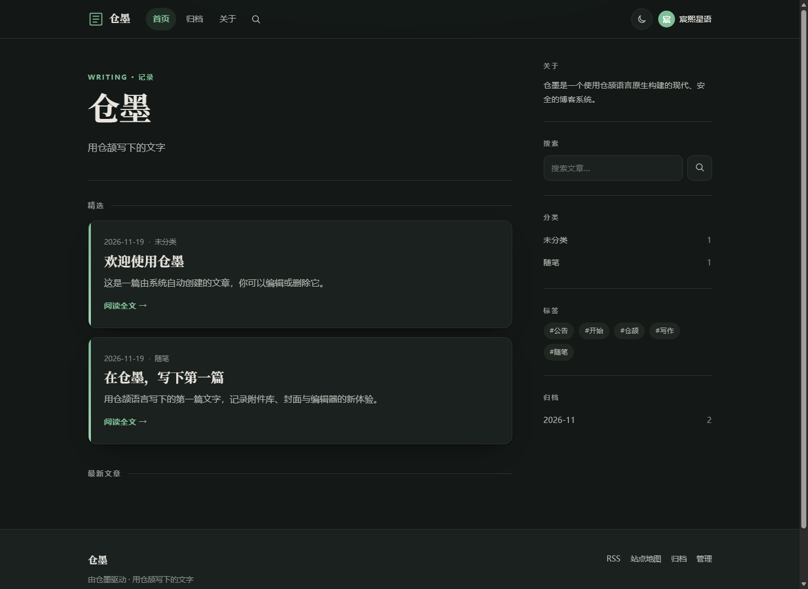
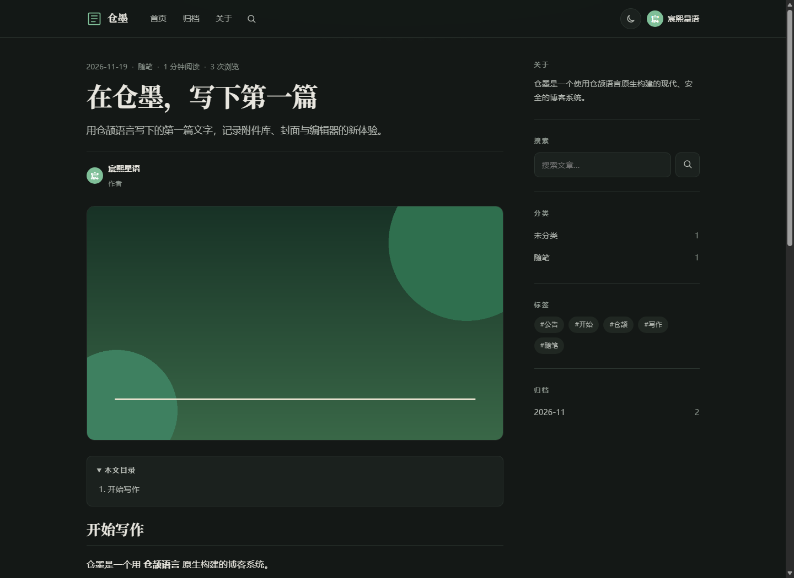
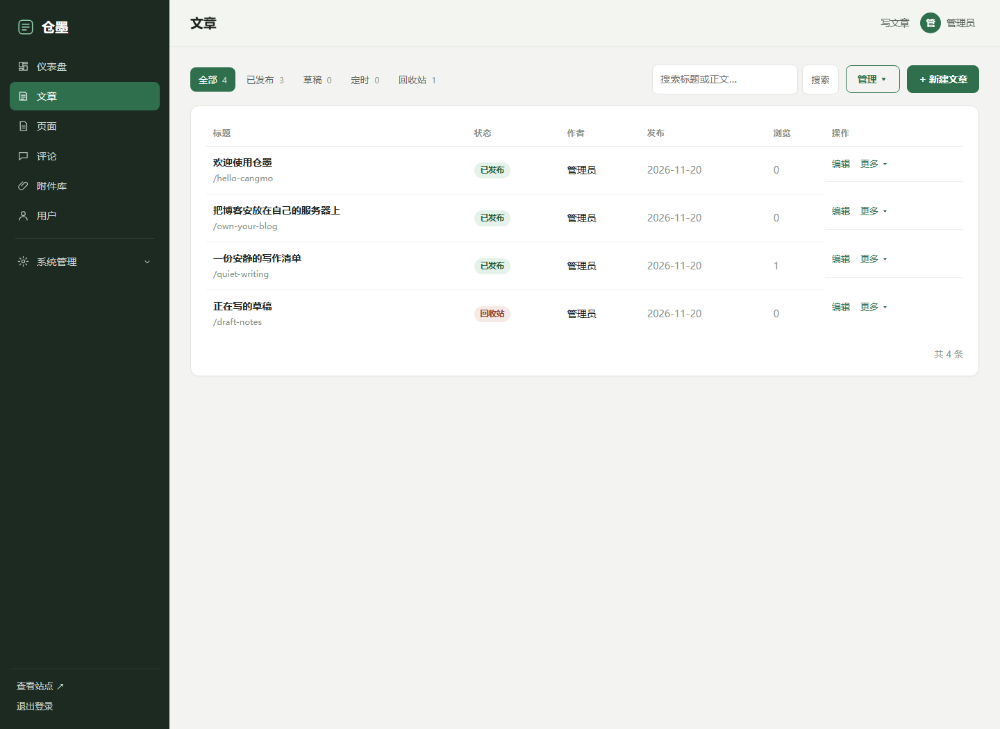
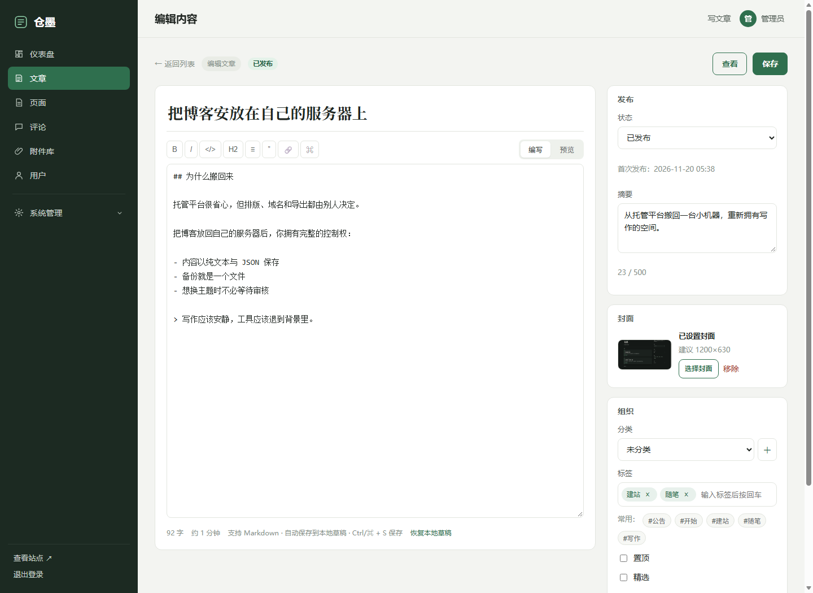
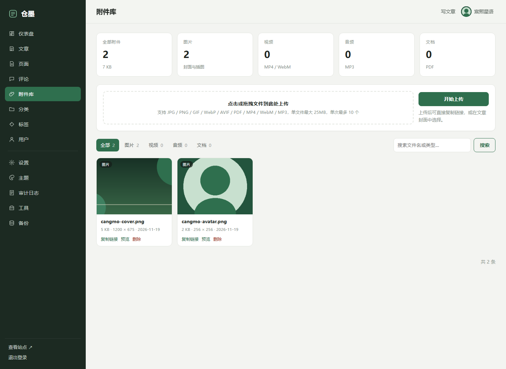
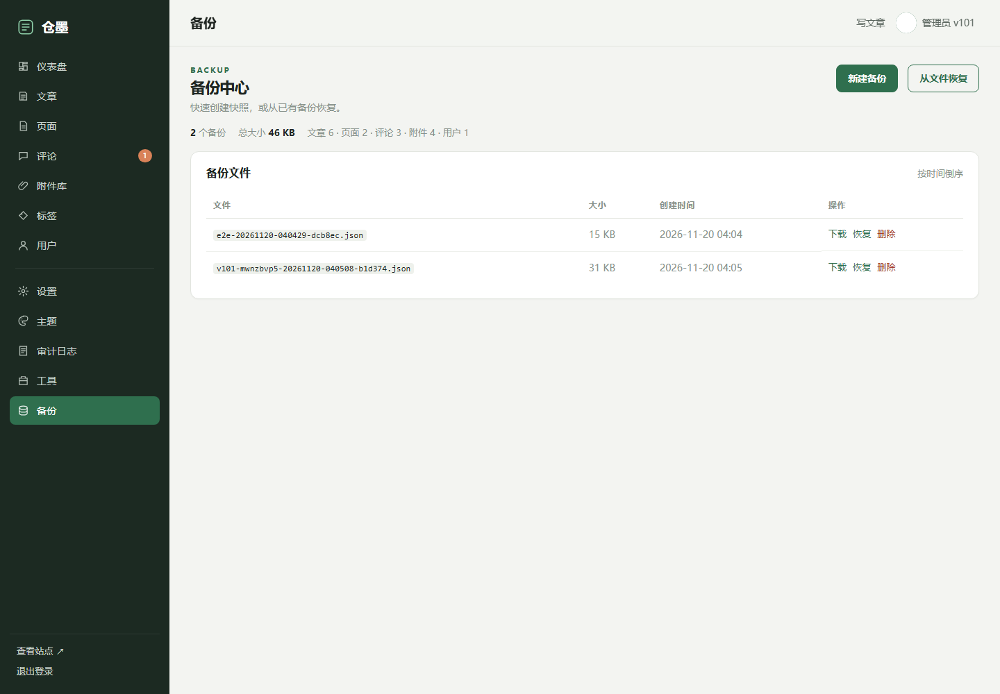
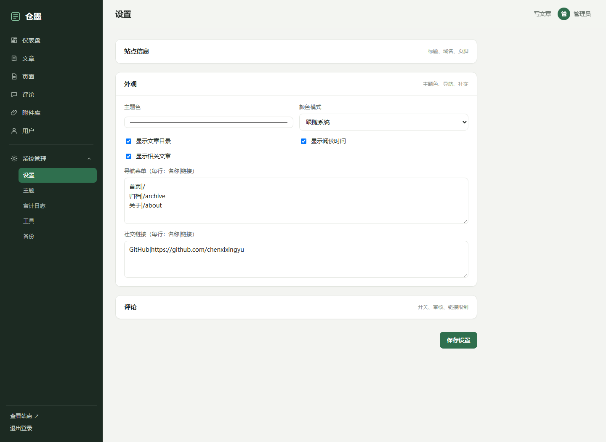
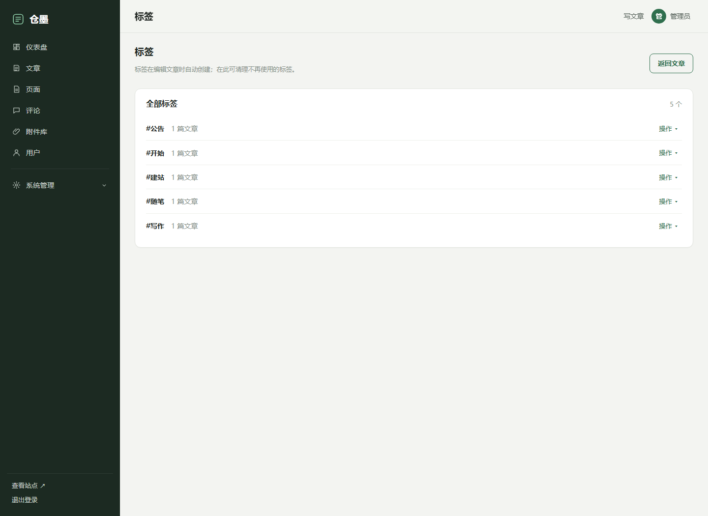

# 仓墨 Cangmo v1.0.5

> 用**仓颉语言**从零构建的现代、安全的博客 / CMS 系统。  
> A modern, secure blog engine written natively in Cangjie.

[](https://github.com/chenxixingyu/cangmo-cms/actions/workflows/ci.yml)
[](https://github.com/chenxixingyu/cangmo-cms/releases)
[](LICENSE)

**仓库**：<https://github.com/chenxixingyu/cangmo-cms>  
**作者**：宸熙星语 (chenxixingyu)



## 为什么是仓墨

- **原生仓颉**：HTTP/1.1 服务器、模板引擎、Markdown 渲染器、JSON 解析器、密码哈希、存储引擎全部用仓颉实现，运行时不依赖任何第三方 Web 框架。
- **自主版权**：代码、模板、样式、脚本均为原创，未复制 Halo、WordPress、Ghost、Typecho 等项目的任何代码或资源；不引用 CDN、外部字体、第三方图标库。详见 [LICENSE](LICENSE) 与 [THIRD_PARTY_NOTICES.md](THIRD_PARTY_NOTICES.md)。
- **安全默认**：CNG / OpenSSL 系统级 CSPRNG、PBKDF2-SHA256（12 万次迭代）、会话轮换、CSRF、严格 CSP、路径穿越防护、上传魔数校验、登录锁定与限流、审计日志。
- **现代体验**：响应式默认主题、深色模式、文章目录、阅读进度、相关文章（可关闭）、代码复制、Markdown 实时预览、PWA、RSS / Sitemap / SEO。
- **内容工作台**：附件库、封面三选一（上传 / 附件库 / 链接）、编辑器内新建分类、标签 Chip、文章批量发布 / 下线 / 回收站、一键复制为草稿、行操作弹出菜单、快捷键保存。
- **跨平台**：Windows x64 使用 CNG，Linux x64 使用 OpenSSL + `getrandom(2)`；GitHub Actions 双平台构建。
- **可运维**：初始化向导、CLI、每日日志、独立备份中心（创建 / 下载 / 恢复 / 删除）、健康检查、定时发布、WAL 崩溃恢复。

## 截图

| 首页 | 文章页（封面） |
| --- | --- |
|  |  |

| 文章管理 | 文章编辑器 |
| --- | --- |
|  |  |

| 附件库 | 备份中心 |
| --- | --- |
|  |  |

| 设置 | 标签管理 |
| --- | --- |
|  |  |

## 快速开始

### 环境

- Windows 10/11 x64 或 Linux x64（glibc 2.25+）
- 仓颉工具链 **1.2.1**（`cjc`、`cjpm`）
- Linux 额外依赖：OpenSSL 开发库（Debian/Ubuntu：`libssl-dev`；Fedora：`openssl-devel`）
- 默认端口 `8080`，Nginx / Caddy 可选

```powershell
# Windows
$env:CANGJIE_HOME = "C:\Program Files (x86)\Cangjie"
$env:Path = "$env:CANGJIE_HOME\runtime\lib\windows_x86_64_cjnative;$env:CANGJIE_HOME\lib\windows_x86_64_cjnative;$env:CANGJIE_HOME\bin;$env:CANGJIE_HOME\tools\bin;$env:CANGJIE_HOME\tools\lib;$env:Path"
cd cangmo
cjpm build
.\target\release\bin\main.exe serve
```

```bash
# Linux（先 source 仓颉 SDK 的 envsetup.sh）
source /path/to/cangjie/envsetup.sh
cd cangmo
./scripts/start.sh
# 或手动：cjpm build && ./target/release/bin/main serve
```

首次启动时控制台会打印初始化令牌：

```
[WARN] [setup] 初始化令牌（Setup token）: xxxxxxxxxxxxxxxx
```

打开 <http://127.0.0.1:8080/setup>，输入令牌、站点标题与管理员账号即可完成初始化。也可以固定令牌：

```powershell
$env:CANGMO_SETUP_TOKEN = "my-setup-token"
.\target\release\bin\main.exe serve
```

### 端口与数据目录

```powershell
.\target\release\bin\main.exe serve --port 9000 --host 127.0.0.1 --data D:\cangmo-data
```

或使用环境变量 `CANGMO_HOST`、`CANGMO_PORT`、`CANGMO_DATA_DIR`、`CANGMO_SECRET`、`CANGMO_DEV`。

## 功能菜单

完整功能清单、版本分层与可选模块见 **[docs/FEATURES.md](docs/FEATURES.md)**。  
v1.0.5 默认交付全部 ✅ 功能；标 ◇ 的模块可按需关闭，标 ○ 的模块在路线图中。

## 常用命令

```text
cangmo serve [--config FILE] [--host HOST] [--port PORT] [--data DIR]
cangmo init
cangmo doctor
cangmo user create <username> <email> [password] [role]
cangmo user reset <username> <new-password>
cangmo user list
cangmo backup [label]
cangmo export [file]
cangmo version
```

`doctor` 会检查数据目录、主题、后台模板、静态资源、安全密钥、WAL 与用户/文章数量，适合部署后自检。

## 目录结构

```text
cangmo/
├─ src/
│  ├─ core/        # 工具、配置、日志、密码学、SHA-256/HMAC/PBKDF2
│  ├─ json/        # RFC 8259 JSON 解析器与序列化器
│  ├─ template/    # 原创模板引擎
│  ├─ markdown/    # 原创 Markdown 渲染器 + XSS 过滤
│  ├─ http/        # HTTP/1.1 服务器、路由、Cookie、Multipart
│  ├─ store/       # 追加日志 + 快照的文档存储
│  ├─ service/     # 领域服务：内容、认证、评论、附件、备份、调度
│  ├─ web/         # 站点、后台、REST API、静态资源
│  └─ main.cj      # CLI 入口
├─ resources/admin/    # 后台模板与静态资源
├─ themes/default/     # 默认主题（原创）
├─ docs/               # 功能、架构、安全、API、部署、测试文档
├─ tests/              # Node 冒烟 / 端到端 / 安全 / 负载测试
└─ data/               # 运行时生成：db.json、wal.log、uploads、logs、backups
```

## 安全要点

- 密码：PBKDF2-HMAC-SHA256（默认 120,000 次迭代；Windows CNG / Linux OpenSSL 加速），随机 16 字节盐，常量时间比较。
- 会话：256-bit 随机令牌，仅以 SHA-256 哈希存库；登录/初始化后轮换；HttpOnly、SameSite=Lax、可配置 Secure。
- CSRF：同步令牌，所有写请求校验；登录、初始化、评论、后台表单均覆盖。
- XSS：模板默认转义，Markdown 默认转义原始 HTML；链接协议白名单；JSON 输出转义 `<>&`。
- 上传：扩展名 + 魔数双重校验，随机文件名，禁用 SVG，大小限制，`nosniff` 响应头。
- 路径：统一解码 + 点段拒绝；静态文件与附件目录二次校验。
- 请求：请求行/请求头/请求体大小限制，读超时，连接数上限，拒绝重复 Content-Length / Transfer-Encoding。
- 响应头：CSP、X-Frame-Options、Referrer-Policy、Permissions-Policy、COOP/CORP、HSTS（HTTPS 时）。
- 审计：登录、内容、评论、设置、用户、主题、备份等关键操作留痕。

完整威胁模型与部署清单见 **[docs/SECURITY.md](docs/SECURITY.md)**。

## 测试

```powershell
cjpm test                                  # 21 个单元测试
node tests\smoke.mjs                       # 初始化 + 公共页面 + 安全头
node tests\e2e.mjs                         # 登录、CRUD、上传、评论、备份、API
node tests\extended.mjs                    # 预览、页面、定时发布、API 更新/删除
node tests\v101.mjs                        # 附件库、编辑器封面/分类、评论批量、备份恢复
node tests\security.mjs                    # CSRF、XSS、路径穿越、请求走私
node tests\load.mjs                        # 并发冒烟
```

测试结果与已知边界见 **[docs/TESTING.md](docs/TESTING.md)**。

## 文档

- [功能清单与选择](docs/FEATURES.md)
- [架构设计](docs/ARCHITECTURE.md)
- [安全设计](docs/SECURITY.md)
- [REST API](docs/API.md)
- [部署运维](docs/DEPLOYMENT.md)
- [测试报告](docs/TESTING.md)
- [更新日志](CHANGELOG.md)

## 许可证

Cangmo 原创代码与资源采用 **Cangmo Source-Available License 1.0**，版权归 **宸熙星语 (chenxixingyu)** 所有。  
第三方工具链（仓颉编译器/运行时）依据其 Apache-2.0 + Runtime Library Exception 使用，详见 [THIRD_PARTY_NOTICES.md](THIRD_PARTY_NOTICES.md) 与 [COPYRIGHT](COPYRIGHT)。

---

**仓墨** · 用仓颉写下的文字。  
© 2026 宸熙星语 (chenxixingyu)
